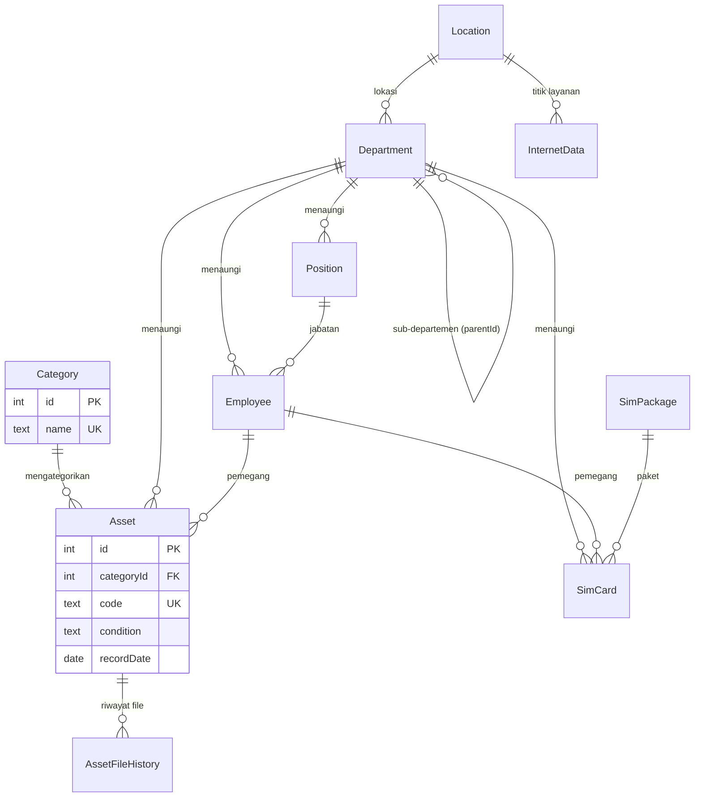

# Dokumentasi Database — App Helpdesk

Dokumen ini menjelaskan struktur database yang dipakai oleh aplikasi **App Helpdesk**
(Next.js 16 + Prisma 6). Skema diambil langsung dari database PostgreSQL yang sedang
berjalan, jadi dokumen ini mencerminkan **kondisi aktual**, bukan hanya isi
`prisma/schema.prisma`.

## Ringkasan

| Item | Nilai |
| --- | --- |
| RDBMS | PostgreSQL 14.24 |
| Database | `helpdesk` |
| Schema | `public` |
| ORM | Prisma Client `^6.19.3` (`prisma@^6.19.3`) |
| Jumlah tabel aplikasi | 13 (+ `_prisma_migrations` milik Prisma) |
| Collation / timezone | default server (`timestamp(3) without time zone`) |

Info koneksi diambil dari `DATABASE_URL` (lihat `.env`, tidak disertakan di sini):

```
postgresql://<user>:<password>@<host>:<port>/helpdesk?schema=public
```

> Catatan: dokumen ini dihasilkan dari introspeksi database via `pg_dump`/`psql`.
> MCP `postgres-documentation` hanya menyediakan pencarian dokumentasi resmi
> PostgreSQL/TimescaleDB dan tidak bisa membaca skema database.

## Daftar Tabel

| Tabel | Kelompok fitur | Fungsi |
| --- | --- | --- |
| `Category` | Master aset | Kategori/klasifikasi aset |
| `Asset` | Aset | Data aset (barang) milik pegawai/departemen |
| `AssetFileHistory` | Aset | Riwayat file (gambar/dokumen) per aset |
| `FileBlob` | Berkas | Penyimpanan berkas biner (bytea) |
| `Employee` | Kepegawaian | Data pegawai |
| `Position` | Kepegawaian | Jabatan (master) |
| `Department` | Organisasi | Departemen berjenjang (self-reference) |
| `Location` | Organisasi | Lokasi/kantor beserta koordinat |
| `SimCard` | SIM Card | Data kartu SIM korporat |
| `SimPackage` | SIM Card | Master paket SIM |
| `InternetData` | Data Internet | Data langganan internet per lokasi |
| `User` | Pengaturan | Akun pengguna aplikasi |
| `Doc` | Dokumentasi | Konten dokumentasi in-app |
| `_prisma_migrations` | Internal | Riwayat migrasi Prisma |

## ERD



## Detail Tabel

Legenda: **PK** = primary key, **UK** = unique, **FK** = foreign key, `?` = kolom boleh NULL.

### Category

| Kolom | Tipe | Null | Default | Keterangan |
| --- | --- | --- | --- | --- |
| `id` | integer | tidak | autoincrement | PK |
| `name` | text | tidak | — | UK, nama kategori |

Relasi: `Category` 1 — * `Asset`.

### Asset

| Kolom | Tipe | Null | Default | Keterangan |
| --- | --- | --- | --- | --- |
| `id` | integer | tidak | autoincrement | PK |
| `categoryId` | integer | tidak | — | FK → `Category.id` |
| `name` | text | tidak | — | Nama aset |
| `code` | text | tidak | — | UK, kode aset |
| `serialNumber` | text | ya | — | Nomor seri |
| `employeeId` | integer | ya | — | FK → `Employee.id` |
| `departmentId` | integer | ya | — | FK → `Department.id` |
| `condition` | text | tidak | `'Good'` | Kondisi (lihat nilai domain) |
| `imageUrl` | text | ya | — | URL gambar |
| `docUrl` | text | ya | — | URL dokumen |
| `recordDate` | date | tidak | — | Tanggal pencatatan |
| `purchaseDate` | date | ya | — | Tanggal pembelian |
| `note` | text | ya | — | Catatan |
| `updatedBy` | text | ya | — | User yang terakhir mengubah |
| `createdAt` | timestamp(3) | tidak | `CURRENT_TIMESTAMP` | Waktu dibuat |
| `updatedAt` | timestamp(3) | tidak | — | Waktu diubah (Prisma `@updatedAt`) |
| `outStatus` | text | ya | — | Status keluar aset |

Index: `Asset_pkey`, `Asset_code_key` (unique), `Asset_categoryId_idx`,
`Asset_condition_idx`, `Asset_departmentId_idx`, `Asset_employeeId_idx`.

### AssetFileHistory

| Kolom | Tipe | Null | Default | Keterangan |
| --- | --- | --- | --- | --- |
| `id` | integer | tidak | autoincrement | PK |
| `assetId` | integer | tidak | — | FK → `Asset.id` |
| `kind` | text | tidak | — | Jenis berkas (`image`, `document`, ...) |
| `url` | text | tidak | — | URL/berkas |
| `fileName` | text | ya | — | Nama berkas asli |
| `createdBy` | text | ya | — | User pembuat |
| `createdAt` | timestamp(3) | tidak | `CURRENT_TIMESTAMP` | Waktu dibuat |

Index: `AssetFileHistory_assetId_kind_createdAt_idx` (`assetId`, `kind`, `createdAt`).

### FileBlob

| Kolom | Tipe | Null | Default | Keterangan |
| --- | --- | --- | --- | --- |
| `id` | integer | tidak | autoincrement | PK |
| `fileName` | text | tidak | — | Nama berkas |
| `mimeType` | text | tidak | — | MIME type |
| `size` | integer | tidak | — | Ukuran (byte) |
| `kind` | text | tidak | — | Jenis berkas |
| `data` | bytea | tidak | — | Isi berkas biner |
| `createdAt` | timestamp(3) | tidak | `CURRENT_TIMESTAMP` | Waktu dibuat |

### Department

| Kolom | Tipe | Null | Default | Keterangan |
| --- | --- | --- | --- | --- |
| `id` | integer | tidak | autoincrement | PK |
| `name` | text | tidak | — | Nama departemen |
| `parentId` | integer | ya | — | FK → `Department.id` (self, hierarki) |
| `createdAt` | timestamp(3) | tidak | `CURRENT_TIMESTAMP` | Waktu dibuat |
| `locationId` | integer | ya | — | FK → `Location.id` |

Index: `Department_parentId_idx`, `Department_locationId_idx`.

### Employee

| Kolom | Tipe | Null | Default | Keterangan |
| --- | --- | --- | --- | --- |
| `id` | integer | tidak | autoincrement | PK |
| `name` | text | tidak | — | Nama pegawai |
| `departmentId` | integer | ya | — | FK → `Department.id` |
| `createdAt` | timestamp(3) | tidak | `CURRENT_TIMESTAMP` | Waktu dibuat |
| `positionId` | integer | ya | — | FK → `Position.id` |

Index: `Employee_departmentId_idx`, `Employee_positionId_idx`.

### Position

| Kolom | Tipe | Null | Default | Keterangan |
| --- | --- | --- | --- | --- |
| `id` | integer | tidak | autoincrement | PK |
| `name` | text | tidak | — | Nama jabatan |
| `departmentId` | integer | ya | — | FK → `Department.id` |
| `createdAt` | timestamp(3) | tidak | `CURRENT_TIMESTAMP` | Waktu dibuat |

Index: `Position_departmentId_idx`.

### Location

| Kolom | Tipe | Null | Default | Keterangan |
| --- | --- | --- | --- | --- |
| `id` | integer | tidak | autoincrement | PK |
| `code` | text | tidak | — | UK, kode lokasi |
| `detailStreetAddress` | text | tidak | — | Alamat detail |
| `latitude` | double precision | ya | — | Koordinat |
| `longitude` | double precision | ya | — | Koordinat |
| `createdAt` | timestamp(3) | tidak | `CURRENT_TIMESTAMP` | Waktu dibuat |
| `address` | text | ya | — | Alamat ringkas |

Index: `Location_code_key` (unique).

### InternetData

| Kolom | Tipe | Null | Default | Keterangan |
| --- | --- | --- | --- | --- |
| `id` | integer | tidak | autoincrement | PK |
| `internetId` | text | tidak | — | UK, ID langganan internet |
| `locationId` | integer | ya | — | FK → `Location.id` |
| `service` | text | tidak | — | Nama layanan |
| `bandwidthMbps` | integer | ya | — | Bandwidth (Mbps) |
| `customerName` | text | tidak | — | Nama pelanggan |
| `monthlyCost` | integer | tidak | — | Biaya bulanan |
| `createdAt` | timestamp(3) | tidak | `CURRENT_TIMESTAMP` | Waktu dibuat |
| `updatedAt` | timestamp(3) | tidak | — | Waktu diubah |
| `detail` | text | ya | — | Detail tambahan |
| `paymentMethod` | text | ya | — | Metode pembayaran |

Index: `InternetData_internetId_key` (unique), `InternetData_locationId_idx`.

### SimCard

| Kolom | Tipe | Null | Default | Keterangan |
| --- | --- | --- | --- | --- |
| `id` | integer | tidak | autoincrement | PK |
| `phoneNumber` | text | tidak | — | UK, nomor telepon |
| `employeeId` | integer | ya | — | FK → `Employee.id` |
| `departmentId` | integer | ya | — | FK → `Department.id` |
| `packageId` | integer | ya | — | FK → `SimPackage.id` |
| `clsDomestic` | text | ya | — | Kelas domestik |
| `clsRoaming` | text | ya | — | Kelas roaming |
| `createdAt` | timestamp(3) | tidak | `CURRENT_TIMESTAMP` | Waktu dibuat |
| `updatedAt` | timestamp(3) | tidak | — | Waktu diubah |
| `terminated` | boolean | tidak | `false` | Status berhenti |
| `note` | text | ya | — | Catatan |

Index: `SimCard_phoneNumber_key` (unique), `SimCard_employeeId_idx`,
`SimCard_departmentId_idx`, `SimCard_packageId_idx`.

### SimPackage

| Kolom | Tipe | Null | Default | Keterangan |
| --- | --- | --- | --- | --- |
| `id` | integer | tidak | autoincrement | PK |
| `name` | text | tidak | — | UK, nama paket |

Relasi: `SimPackage` 1 — * `SimCard`.

### User

| Kolom | Tipe | Null | Default | Keterangan |
| --- | --- | --- | --- | --- |
| `id` | integer | tidak | autoincrement | PK |
| `username` | text | tidak | — | UK, nama pengguna |
| `passwordHash` | text | tidak | — | Hash password (bcrypt) |
| `name` | text | tidak | — | Nama tampilan |
| `createdAt` | timestamp(3) | tidak | `CURRENT_TIMESTAMP` | Waktu dibuat |
| `role` | text | tidak | `'admin'` | Peran (lihat nilai domain) |

### Doc

| Kolom | Tipe | Null | Default | Keterangan |
| --- | --- | --- | --- | --- |
| `id` | integer | tidak | autoincrement | PK |
| `slug` | text | tidak | — | UK, slug dokumen |
| `title` | text | tidak | — | Judul |
| `summary` | text | ya | — | Ringkasan |
| `content` | text | tidak | — | Isi (markdown) |
| `updatedBy` | text | ya | — | User terakhir mengubah |
| `createdAt` | timestamp(3) | tidak | `CURRENT_TIMESTAMP` | Waktu dibuat |
| `updatedAt` | timestamp(3) | tidak | — | Waktu diubah |

## Relasi & Aturan ON DELETE

Semua FK memakai `ON UPDATE CASCADE`. Aturan `ON DELETE`:

| Child | Kolom | Parent | ON DELETE |
| --- | --- | --- | --- |
| `Asset` | `categoryId` | `Category` | RESTRICT |
| `Asset` | `employeeId` | `Employee` | SET NULL |
| `Asset` | `departmentId` | `Department` | SET NULL |
| `AssetFileHistory` | `assetId` | `Asset` | CASCADE |
| `Employee` | `departmentId` | `Department` | RESTRICT |
| `Employee` | `positionId` | `Position` | SET NULL |
| `Position` | `departmentId` | `Department` | CASCADE |
| `Department` | `parentId` | `Department` | RESTRICT |
| `Department` | `locationId` | `Location` | SET NULL |
| `InternetData` | `locationId` | `Location` | RESTRICT |
| `SimCard` | `employeeId` | `Employee` | SET NULL |
| `SimCard` | `departmentId` | `Department` | SET NULL |
| `SimCard` | `packageId` | `SimPackage` | SET NULL |

## Nilai Domain (Enum Aplikasi)

Database menyimpan beberapa kolom sebagai `text` tanpa constraint, nilainya ditegakkan
di level aplikasi:

| Kolom | Nilai valid | Sumber |
| --- | --- | --- |
| `Asset.condition` | `Good`, `Fair`, `Damaged`, `Under Repair` | `lib/types.ts` (`CONDITIONS`) |
| `User.role` | `admin`, `guest` | `lib/types.ts` (`ROLES`) |
| `AssetFileHistory.kind` | mis. `image`, `document` | pemakaian di `lib/asset-history.ts` |

## Riwayat Migrasi

Migrasi diterapkan lewat Prisma Migrate (`prisma/migrations/`):

| Migrasi | Diterapkan |
| --- | --- |
| `20260918085524_init` | 2026-09-18 15:55 |
| `20260918131700_add_file_blob` | 2026-09-18 20:17 |
| `20260919140000_location_address_split` | 2026-09-19 20:40 |
| `20260919160000_add_user_role` | 2026-09-19 22:42 |
| `20260919180000_internet_detail_payment` | 2026-09-19 23:38 |
| `20260919200000_sim_card_terminated` | 2026-09-20 00:06 |
| `20260919220000_sim_card_note` | 2026-09-20 00:35 |
| `20260920054139_add_doc` | 2026-09-20 12:41 |
| `20260924034357_add_asset_file_history` | 2026-09-24 10:43 |
| `20260930161847_department_location` | 2026-09-30 23:18 |
| `20260930164004_employee_position` | 2026-09-30 23:40 |
| `20260930171116_position_master` | 2026-10-01 00:11 |
| `20261012100000_add_asset_out_status` | 2026-10-12 23:19 |

## Temuan & Catatan Penting

1. **Kolom `text` tanpa constraint** untuk `condition` dan `role`.
   Pertimbangkan enum/`CHECK` bila ingin validasi di level database.

2. Beberapa waktu memakai `timestamp(3) without time zone` (presisi milidetik).
   Tanpa zona waktu, aplikasi harus konsisten menyimpan nilai dalam satu zona acuan.

## Perbandingan Lokal vs Backup Produksi (2026-10-14)

Audit terhadap `backups/backup-20261014-112323(test-production).dump` (PostgreSQL 14.24).
Diff katalog: `pg_tables`, `information_schema.columns`, `pg_indexes`, `pg_constraint`,
`information_schema.sequences`, `_prisma_migrations`.

| Aspek | Sebelum | Sesudah | Produksi |
| --- | --- | --- | --- |
| Tabel di schema `public` | 16 | 14 | 14 |
| Perbedaan skema (kolom/index/constraint/sequence) | 32 | 0 | — |
| Migrasi (`_prisma_migrations`) | 13 | 13 | 13 (nama + checksum identik) |

### Anomali yang Ditemukan

| No | Kategori | Temuan | Lokasi | Tindakan |
| --- | --- | --- | --- | --- |
| 1 | Database | `Ticket` & `TicketComment` (+2 sequence, 6 index, 7 constraint) ada di DB lokal, tidak ada di dump produksi maupun `schema.prisma`. FK keduanya menahan `DROP CONSTRAINT "User_pkey"` saat `--clean` → **penyebab restore gagal** | DB lokal `helpdesk` | `DROP TABLE … CASCADE` |
| 2 | Kode | `runPgRestore()` memakai `--clean --if-exists`; flag ini hanya menghapus objek yang ada di arsip, jadi objek "sisa" di DB target memblokir penghapusan | `lib/server/pg-tools.ts` | Reset schema (`DROP SCHEMA public CASCADE; CREATE SCHEMA public;`) lalu restore tanpa `--clean` |
| 3 | Kode | `archiveMismatch()` salah memetakan versi arsip (minor 15→16, ≥16→17) | `lib/server/pg-tools.ts` | Tabel `ARCHIVE_MIN_RESTORE` (1.14→13, 1.15→16, 1.16→17) |
| 4 | Dokumentasi | Dokumen mencantumkan `Ticket`/`TicketComment` sebagai tabel yang ada di DB | `docs/DATABASE.md` | Dihapus |
| 5 | Dokumentasi | Riwayat migrasi mencantumkan `20261008140751_add_tickets` (tidak ada di DB/folder) & melewatkan `20261012100000_add_asset_out_status` | `docs/DATABASE.md` | Dikoreksi |
| 6 | Dokumentasi | Kolom `Asset.outStatus` tidak terdokumentasi | `docs/DATABASE.md` | Ditambahkan |
| 7 | Dokumentasi | "Jumlah tabel aplikasi" tertulis 15 (seharusnya 13) | `docs/DATABASE.md` | Dikoreksi |
| 8 | Dokumentasi | Disebut ada folder kosong `app/(app)/tickets/[id]` & `app/api/tickets/[id]` | repo | Referensi dihapus (folder ternyata tidak ada) |
| 9 | Repositori | Branch lokal `feature/tickets` masih tersisa (identik `master`, tanpa berkas ticket) | git | Branch dihapus |
| 10 | Backup store | `isValidBackupName()` menolak nama `backup-20261014-112323(test-production).dump` sehingga tidak muncul di daftar Restore UI (harus lewat "Restore from file") | `lib/server/db-backup-store.ts` | Dicatat — belum diubah |

### Perbedaan Data (bukan skema)

| Tabel | Lokal | Produksi |
| --- | --- | --- |
| `Asset` | 371 | 366 |
| `User` | 2 | 1 |
| Tabel lain (12 tabel) | sama | sama |

### Verifikasi

| Uji | Hasil |
| --- | --- |
| `runPgRestore()` dijalankan pada DB yang sengaja diberi tabel sisa ber-FK (skenario yang tadinya gagal) | exit 0, stderr kosong, tabel sisa terhapus, kembali 14 tabel |
| Diff skema lokal vs produksi | 0 perbedaan |
| `npx tsc --noEmit` / `npx eslint lib/server/pg-tools.ts` | lolos |
| Browser `/login`, `/`, `/pengaturan/backup-restore` | tampil normal, tanpa menu/error terkait ticket |

## Import Gambar & BAST Laptop (2026-10-14)

Sumber: `sample-import/LAPTOP-20261014T111838Z-1-001/LAPTOP/<serial>/{IMAGES|Images|IMAGE, BAST}`.
Skrip: `scripts/attach-laptop-files.mts` — lewat `POST /api/files` (kind `image`/`document`)
lalu `PUT /api/assets/<id>`.

Aturan yang dipakai: gambar = file dengan **tanggal di nama file** paling baru;
dokumen = BAST bertanggal paling baru (file `[UNSIGNED]` dilewati bila ada alternatif lain);
file yang serialnya tidak cocok dengan folder dilewati bila ada alternatif lain;
aset yang sudah punya gambar/dokumen **ditimpa** (versi lama masuk `AssetFileHistory`).

### Hasil

| Status | Jumlah | Keterangan |
| --- | --- | --- |
| Berhasil | 111 | gambar terpasang (108 juga dapat dokumen) |
| Gagal | 18 | file > 2 MB — ditolak batas upload API |
| Dilewati | 14 | 13 folder tanpa data aset + `KYT76W62Q4` (folder kosong) |

| Item | Nilai |
| --- | --- |
| Folder serial | 143 |
| Aset laptop cocok | 130 (semua laptop punya folder) |
| Aset bergambar (`imageUrl`) | 111 |
| Aset ber-BAST (`docUrl`) | 108 |
| `FileBlob` baru | 219 (111 image + 108 document) |
| Riwayat file lama | 3 |

### Ketidakcocokan yang ditemukan

| No | Kategori | Jumlah | Detail |
| --- | --- | --- | --- |
| 1 | Folder tanpa data aset | 13 | `4DJGZK3`, `57SLZK3`, `5CD1379V63`, `6N1Q0J3`, `6W06863`, `C02M61W7FD59`, `C4B1JK3`, `FR1D9Y2`, `MP2HQ5QC`, `PF4WJ05X`, `PF4XR6VP`, `PW0349LL`, `YX0G25KS` |
| 2 | Folder tanpa file | 1 | `KYT76W62Q4` — IMAGES & BAST kosong |
| 3 | Nama folder gambar tidak konsisten | 104 | mayoritas `IMAGES`, sebagian `Images`, 1 `IMAGE` (`SF5V0JK3`) |
| 4 | Dokumen `[UNSIGNED]` dilewati | 26 | ada versi BAST lain di folder yang sama |
| 5 | Serial di nama file ≠ folder | 6 | mis. `PF4XQ4A0/BAST/…J67GYH3.pdf`, `DBDFZK3/BAST/…D2DFZK3.pdf`, `C63GZK3/BAST/…R9CX704C6YT.pdf` (serial HP), `J87KNJ3/BAST/…787KNJ3.pdf` (typo), `4DJGZK3/BAST/…4DJGK3.pdf` (typo) |
| 6 | File bukan gambar/PDF | 3 | 2 `.docx` (PF4YY7PD, H3WTRV3), 1 `.tmp` (G37GYH3) |
| 7 | File di root folder serial | 2 | `PF5KJVH6/INVOICE - PF5KJVH6.pdf`, `PF5BDD3A/INVOICE LAPTOP - PF5BDD3A.pdf` |
| 8 | Gambar tersimpan di folder BAST | 1 | `PF59R4P1/BAST/06042026 - BAST LAPTOP - CHARTER - PF59R4P1.jpg` |
| 9 | `serialNumber` duplikat di data aset | 2 | `X21K00733` (014-B/V/2023 + 024-B/V/2023), `NK6F002499` (020-B/V/2023 + 023-B/V/2023) — keduanya Printer |

Aset yang dapat gambar tetapi tidak punya BAST (tidak ada PDF di foldernya):
`NFJDGVX42C` (aset 2), `PF4HEQ19` (aset 74), `PF4LB6MP` (aset 76).

### Aset gagal karena melebihi batas 2 MB

`1YVTHK3`, `29Z82Z2`, `58KDYH3`, `5GLGYH3`, `7F3TZK3`, `7TRLZK3`, `8YKFZK3`, `9HCDYH3`,
`JV3T5D3`, `MP2DXQGV`, `MP2HQ3KB`, `MP2NM0E7`, `MP2NXN3H`, `PF4K6X90`, `PF4W4489`, `PF4Z2J15`
(gambar) serta `CRKFZK3`, `MP2HQ1R1`, `MP2HQ1RM` (BAST 10 MB).

Batas `UPLOAD_KINDS` di `lib/uploads.ts` = 2 MB dan diperiksa **sebelum** kompresi, sehingga
file besar ditolak walau hasil WebP-nya akan kecil.

## Cara Regenerasi Dokumentasi

Dump skema aktual:

```bash
pg_dump -h 127.0.0.1 -p 5432 -U postgres -d helpdesk --schema-only --schema=public --no-owner --no-privileges
```

Atau introspeksi Prisma ke schema:

```bash
npx prisma db pull
```

Verbose (kolom, constraint, index) dalam bentuk query:

```sql
SELECT table_name, column_name, data_type, is_nullable, column_default
FROM information_schema.columns
WHERE table_schema = 'public'
ORDER BY table_name, ordinal_position;
```
