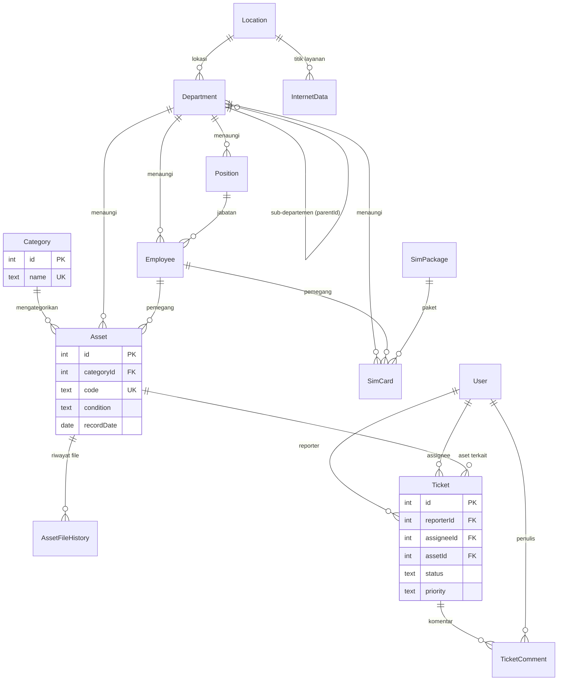

# Dokumentasi Database — App Helpdesk

Dokumen ini menjelaskan struktur database yang dipakai oleh aplikasi **App Helpdesk**
(Next.js 16 + Prisma 6). Skema diambil langsung dari database PostgreSQL yang sedang
berjalan, jadi dokumen ini mencerminkan **kondisi aktual**, bukan hanya isi
`prisma/schema.prisma`.

## Ringkasan

| Item | Nilai |
| --- | --- |
| RDBMS | PostgreSQL 14.24 |
| Database | `helpdesk` |
| Schema | `public` |
| ORM | Prisma Client `^6.19.3` (`prisma@^6.19.3`) |
| Jumlah tabel aplikasi | 15 (+ `_prisma_migrations` milik Prisma) |
| Collation / timezone | default server (`timestamp(3) without time zone`) |

Info koneksi diambil dari `DATABASE_URL` (lihat `.env`, tidak disertakan di sini):

```
postgresql://<user>:<password>@<host>:<port>/helpdesk?schema=public
```

> Catatan: dokumen ini dihasilkan dari introspeksi database via `pg_dump`/`psql`.
> MCP `postgres-documentation` hanya menyediakan pencarian dokumentasi resmi
> PostgreSQL/TimescaleDB dan tidak bisa membaca skema database.

## Daftar Tabel

| Tabel | Kelompok fitur | Fungsi |
| --- | --- | --- |
| `Category` | Master aset | Kategori/klasifikasi aset |
| `Asset` | Aset | Data aset (barang) milik pegawai/departemen |
| `AssetFileHistory` | Aset | Riwayat file (gambar/dokumen) per aset |
| `FileBlob` | Berkas | Penyimpanan berkas biner (bytea) |
| `Employee` | Kepegawaian | Data pegawai |
| `Position` | Kepegawaian | Jabatan (master) |
| `Department` | Organisasi | Departemen berjenjang (self-reference) |
| `Location` | Organisasi | Lokasi/kantor beserta koordinat |
| `SimCard` | SIM Card | Data kartu SIM korporat |
| `SimPackage` | SIM Card | Master paket SIM |
| `InternetData` | Data Internet | Data langganan internet per lokasi |
| `User` | Pengaturan | Akun pengguna aplikasi |
| `Doc` | Dokumentasi | Konten dokumentasi in-app |
| `Ticket` | Tiket | Tiket bantuan *(tabel ada di DB, belum dipakai kode)* |
| `TicketComment` | Tiket | Komentar tiket *(tabel ada di DB, belum dipakai kode)* |
| `_prisma_migrations` | Internal | Riwayat migrasi Prisma |

## ERD



## Detail Tabel

Legenda: **PK** = primary key, **UK** = unique, **FK** = foreign key, `?` = kolom boleh NULL.

### Category

| Kolom | Tipe | Null | Default | Keterangan |
| --- | --- | --- | --- | --- |
| `id` | integer | tidak | autoincrement | PK |
| `name` | text | tidak | — | UK, nama kategori |

Relasi: `Category` 1 — * `Asset`.

### Asset

| Kolom | Tipe | Null | Default | Keterangan |
| --- | --- | --- | --- | --- |
| `id` | integer | tidak | autoincrement | PK |
| `categoryId` | integer | tidak | — | FK → `Category.id` |
| `name` | text | tidak | — | Nama aset |
| `code` | text | tidak | — | UK, kode aset |
| `serialNumber` | text | ya | — | Nomor seri |
| `employeeId` | integer | ya | — | FK → `Employee.id` |
| `departmentId` | integer | ya | — | FK → `Department.id` |
| `condition` | text | tidak | `'Good'` | Kondisi (lihat nilai domain) |
| `imageUrl` | text | ya | — | URL gambar |
| `docUrl` | text | ya | — | URL dokumen |
| `recordDate` | date | tidak | — | Tanggal pencatatan |
| `purchaseDate` | date | ya | — | Tanggal pembelian |
| `note` | text | ya | — | Catatan |
| `updatedBy` | text | ya | — | User yang terakhir mengubah |
| `createdAt` | timestamp(3) | tidak | `CURRENT_TIMESTAMP` | Waktu dibuat |
| `updatedAt` | timestamp(3) | tidak | — | Waktu diubah (Prisma `@updatedAt`) |

Index: `Asset_pkey`, `Asset_code_key` (unique), `Asset_categoryId_idx`,
`Asset_condition_idx`, `Asset_departmentId_idx`, `Asset_employeeId_idx`.

### AssetFileHistory

| Kolom | Tipe | Null | Default | Keterangan |
| --- | --- | --- | --- | --- |
| `id` | integer | tidak | autoincrement | PK |
| `assetId` | integer | tidak | — | FK → `Asset.id` |
| `kind` | text | tidak | — | Jenis berkas (`image`, `document`, ...) |
| `url` | text | tidak | — | URL/berkas |
| `fileName` | text | ya | — | Nama berkas asli |
| `createdBy` | text | ya | — | User pembuat |
| `createdAt` | timestamp(3) | tidak | `CURRENT_TIMESTAMP` | Waktu dibuat |

Index: `AssetFileHistory_assetId_kind_createdAt_idx` (`assetId`, `kind`, `createdAt`).

### FileBlob

| Kolom | Tipe | Null | Default | Keterangan |
| --- | --- | --- | --- | --- |
| `id` | integer | tidak | autoincrement | PK |
| `fileName` | text | tidak | — | Nama berkas |
| `mimeType` | text | tidak | — | MIME type |
| `size` | integer | tidak | — | Ukuran (byte) |
| `kind` | text | tidak | — | Jenis berkas |
| `data` | bytea | tidak | — | Isi berkas biner |
| `createdAt` | timestamp(3) | tidak | `CURRENT_TIMESTAMP` | Waktu dibuat |

### Department

| Kolom | Tipe | Null | Default | Keterangan |
| --- | --- | --- | --- | --- |
| `id` | integer | tidak | autoincrement | PK |
| `name` | text | tidak | — | Nama departemen |
| `parentId` | integer | ya | — | FK → `Department.id` (self, hierarki) |
| `createdAt` | timestamp(3) | tidak | `CURRENT_TIMESTAMP` | Waktu dibuat |
| `locationId` | integer | ya | — | FK → `Location.id` |

Index: `Department_parentId_idx`, `Department_locationId_idx`.

### Employee

| Kolom | Tipe | Null | Default | Keterangan |
| --- | --- | --- | --- | --- |
| `id` | integer | tidak | autoincrement | PK |
| `name` | text | tidak | — | Nama pegawai |
| `departmentId` | integer | ya | — | FK → `Department.id` |
| `createdAt` | timestamp(3) | tidak | `CURRENT_TIMESTAMP` | Waktu dibuat |
| `positionId` | integer | ya | — | FK → `Position.id` |

Index: `Employee_departmentId_idx`, `Employee_positionId_idx`.

### Position

| Kolom | Tipe | Null | Default | Keterangan |
| --- | --- | --- | --- | --- |
| `id` | integer | tidak | autoincrement | PK |
| `name` | text | tidak | — | Nama jabatan |
| `departmentId` | integer | ya | — | FK → `Department.id` |
| `createdAt` | timestamp(3) | tidak | `CURRENT_TIMESTAMP` | Waktu dibuat |

Index: `Position_departmentId_idx`.

### Location

| Kolom | Tipe | Null | Default | Keterangan |
| --- | --- | --- | --- | --- |
| `id` | integer | tidak | autoincrement | PK |
| `code` | text | tidak | — | UK, kode lokasi |
| `detailStreetAddress` | text | tidak | — | Alamat detail |
| `latitude` | double precision | ya | — | Koordinat |
| `longitude` | double precision | ya | — | Koordinat |
| `createdAt` | timestamp(3) | tidak | `CURRENT_TIMESTAMP` | Waktu dibuat |
| `address` | text | ya | — | Alamat ringkas |

Index: `Location_code_key` (unique).

### InternetData

| Kolom | Tipe | Null | Default | Keterangan |
| --- | --- | --- | --- | --- |
| `id` | integer | tidak | autoincrement | PK |
| `internetId` | text | tidak | — | UK, ID langganan internet |
| `locationId` | integer | ya | — | FK → `Location.id` |
| `service` | text | tidak | — | Nama layanan |
| `bandwidthMbps` | integer | ya | — | Bandwidth (Mbps) |
| `customerName` | text | tidak | — | Nama pelanggan |
| `monthlyCost` | integer | tidak | — | Biaya bulanan |
| `createdAt` | timestamp(3) | tidak | `CURRENT_TIMESTAMP` | Waktu dibuat |
| `updatedAt` | timestamp(3) | tidak | — | Waktu diubah |
| `detail` | text | ya | — | Detail tambahan |
| `paymentMethod` | text | ya | — | Metode pembayaran |

Index: `InternetData_internetId_key` (unique), `InternetData_locationId_idx`.

### SimCard

| Kolom | Tipe | Null | Default | Keterangan |
| --- | --- | --- | --- | --- |
| `id` | integer | tidak | autoincrement | PK |
| `phoneNumber` | text | tidak | — | UK, nomor telepon |
| `employeeId` | integer | ya | — | FK → `Employee.id` |
| `departmentId` | integer | ya | — | FK → `Department.id` |
| `packageId` | integer | ya | — | FK → `SimPackage.id` |
| `clsDomestic` | text | ya | — | Kelas domestik |
| `clsRoaming` | text | ya | — | Kelas roaming |
| `createdAt` | timestamp(3) | tidak | `CURRENT_TIMESTAMP` | Waktu dibuat |
| `updatedAt` | timestamp(3) | tidak | — | Waktu diubah |
| `terminated` | boolean | tidak | `false` | Status berhenti |
| `note` | text | ya | — | Catatan |

Index: `SimCard_phoneNumber_key` (unique), `SimCard_employeeId_idx`,
`SimCard_departmentId_idx`, `SimCard_packageId_idx`.

### SimPackage

| Kolom | Tipe | Null | Default | Keterangan |
| --- | --- | --- | --- | --- |
| `id` | integer | tidak | autoincrement | PK |
| `name` | text | tidak | — | UK, nama paket |

Relasi: `SimPackage` 1 — * `SimCard`.

### User

| Kolom | Tipe | Null | Default | Keterangan |
| --- | --- | --- | --- | --- |
| `id` | integer | tidak | autoincrement | PK |
| `username` | text | tidak | — | UK, nama pengguna |
| `passwordHash` | text | tidak | — | Hash password (bcrypt) |
| `name` | text | tidak | — | Nama tampilan |
| `createdAt` | timestamp(3) | tidak | `CURRENT_TIMESTAMP` | Waktu dibuat |
| `role` | text | tidak | `'admin'` | Peran (lihat nilai domain) |

### Doc

| Kolom | Tipe | Null | Default | Keterangan |
| --- | --- | --- | --- | --- |
| `id` | integer | tidak | autoincrement | PK |
| `slug` | text | tidak | — | UK, slug dokumen |
| `title` | text | tidak | — | Judul |
| `summary` | text | ya | — | Ringkasan |
| `content` | text | tidak | — | Isi (markdown) |
| `updatedBy` | text | ya | — | User terakhir mengubah |
| `createdAt` | timestamp(3) | tidak | `CURRENT_TIMESTAMP` | Waktu dibuat |
| `updatedAt` | timestamp(3) | tidak | — | Waktu diubah |

### Ticket

| Kolom | Tipe | Null | Default | Keterangan |
| --- | --- | --- | --- | --- |
| `id` | integer | tidak | autoincrement | PK |
| `title` | text | tidak | — | Judul tiket |
| `description` | text | tidak | — | Deskripsi |
| `status` | text | tidak | `'open'` | Status tiket |
| `priority` | text | tidak | `'normal'` | Prioritas |
| `reporterId` | integer | tidak | — | FK → `User.id` (pelapor) |
| `assigneeId` | integer | ya | — | FK → `User.id` (penanggung jawab) |
| `assetId` | integer | ya | — | FK → `Asset.id` (aset terkait) |
| `createdAt` | timestamp(3) | tidak | `CURRENT_TIMESTAMP` | Waktu dibuat |
| `updatedAt` | timestamp(3) | tidak | — | Waktu diubah |

Index: `Ticket_reporterId_idx`, `Ticket_assigneeId_idx`, `Ticket_status_idx`.

### TicketComment

| Kolom | Tipe | Null | Default | Keterangan |
| --- | --- | --- | --- | --- |
| `id` | integer | tidak | autoincrement | PK |
| `ticketId` | integer | tidak | — | FK → `Ticket.id` |
| `userId` | integer | tidak | — | FK → `User.id` |
| `body` | text | tidak | — | Isi komentar |
| `createdAt` | timestamp(3) | tidak | `CURRENT_TIMESTAMP` | Waktu dibuat |

Index: `TicketComment_ticketId_idx`.

## Relasi & Aturan ON DELETE

Semua FK memakai `ON UPDATE CASCADE`. Aturan `ON DELETE`:

| Child | Kolom | Parent | ON DELETE |
| --- | --- | --- | --- |
| `Asset` | `categoryId` | `Category` | RESTRICT |
| `Asset` | `employeeId` | `Employee` | SET NULL |
| `Asset` | `departmentId` | `Department` | SET NULL |
| `AssetFileHistory` | `assetId` | `Asset` | CASCADE |
| `Employee` | `departmentId` | `Department` | RESTRICT |
| `Employee` | `positionId` | `Position` | SET NULL |
| `Position` | `departmentId` | `Department` | CASCADE |
| `Department` | `parentId` | `Department` | RESTRICT |
| `Department` | `locationId` | `Location` | SET NULL |
| `InternetData` | `locationId` | `Location` | RESTRICT |
| `SimCard` | `employeeId` | `Employee` | SET NULL |
| `SimCard` | `departmentId` | `Department` | SET NULL |
| `SimCard` | `packageId` | `SimPackage` | SET NULL |
| `Ticket` | `reporterId` | `User` | RESTRICT |
| `Ticket` | `assigneeId` | `User` | SET NULL |
| `Ticket` | `assetId` | `Asset` | SET NULL |
| `TicketComment` | `ticketId` | `Ticket` | CASCADE |
| `TicketComment` | `userId` | `User` | RESTRICT |

## Nilai Domain (Enum Aplikasi)

Database menyimpan beberapa kolom sebagai `text` tanpa constraint, nilainya ditegakkan
di level aplikasi:

| Kolom | Nilai valid | Sumber |
| --- | --- | --- |
| `Asset.condition` | `Good`, `Fair`, `Damaged`, `Under Repair` | `lib/types.ts` (`CONDITIONS`) |
| `User.role` | `admin`, `guest` | `lib/types.ts` (`ROLES`) |
| `Ticket.status` | default `open` (nilai lain belum didefinisikan di kode) | — |
| `Ticket.priority` | default `normal` (nilai lain belum didefinisikan di kode) | — |
| `AssetFileHistory.kind` | mis. `image`, `document` | pemakaian di `lib/asset-history.ts` |

## Riwayat Migrasi

Migrasi diterapkan lewat Prisma Migrate (`prisma/migrations/`):

| Migrasi | Diterapkan |
| --- | --- |
| `20260918085524_init` | 2026-09-18 15:55 |
| `20260918131700_add_file_blob` | 2026-09-18 20:17 |
| `20260919140000_location_address_split` | 2026-09-19 20:40 |
| `20260919160000_add_user_role` | 2026-09-19 22:42 |
| `20260919180000_internet_detail_payment` | 2026-09-19 23:38 |
| `20260919200000_sim_card_terminated` | 2026-09-20 00:06 |
| `20260919220000_sim_card_note` | 2026-09-20 00:35 |
| `20260920054139_add_doc` | 2026-09-20 12:41 |
| `20260924034357_add_asset_file_history` | 2026-09-24 10:43 |
| `20260930161847_department_location` | 2026-09-30 23:18 |
| `20260930164004_employee_position` | 2026-09-30 23:40 |
| `20260930171116_position_master` | 2026-10-01 00:11 |
| `20261008140751_add_tickets` | 2026-10-08 21:07 |

## Temuan & Catatan Penting

1. **`Ticket` & `TicketComment` tidak ada di `prisma/schema.prisma`.**
   Kedua tabel sudah diterapkan ke database (migrasi `20261008140751_add_tickets`),
   tetapi modelnya tidak ada di `schema.prisma`, sehingga Prisma Client **tidak mengenali
   keduanya**. Fitur di aplikasi pun hanya berupa folder kosong
   (`app/(app)/tickets/[id]`, `app/api/tickets/[id]`). Sinkronkan kembali model ke
   `schema.prisma` sebelum memakai fitur tiket.

2. **Folder migrasi `add_tickets` kosong** (tidak ada `migration.sql`), padahal
   migrasi tercatat sudah diterapkan. Perlu ditelusuri agar riwayat migrasi konsisten.

3. **Kolom `text` tanpa constraint** untuk `condition`, `role`, `status`, `priority`.
   Pertimbangkan enum/`CHECK` bila ingin validasi di level database.

4. Beberapa waktu memakai `timestamp(3) without time zone` (presisi milidetik).
   Tanpa zona waktu, aplikasi harus konsisten menyimpan nilai dalam satu zona acuan.

## Cara Regenerasi Dokumentasi

Dump skema aktual:

```bash
pg_dump -h 127.0.0.1 -p 5432 -U postgres -d helpdesk --schema-only --schema=public --no-owner --no-privileges
```

Atau introspeksi Prisma ke schema:

```bash
npx prisma db pull
```

Verbose (kolom, constraint, index) dalam bentuk query:

```sql
SELECT table_name, column_name, data_type, is_nullable, column_default
FROM information_schema.columns
WHERE table_schema = 'public'
ORDER BY table_name, ordinal_position;
```
